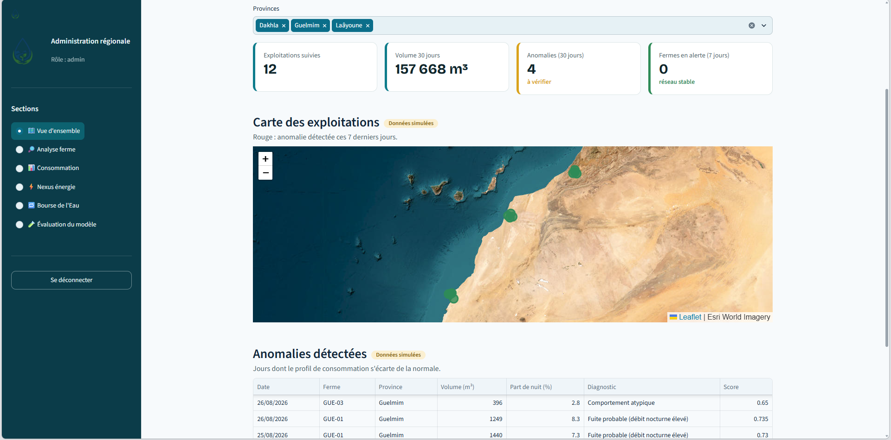
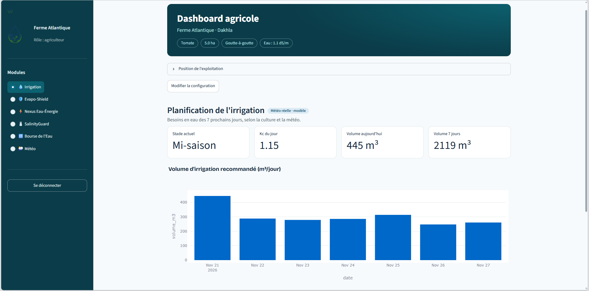
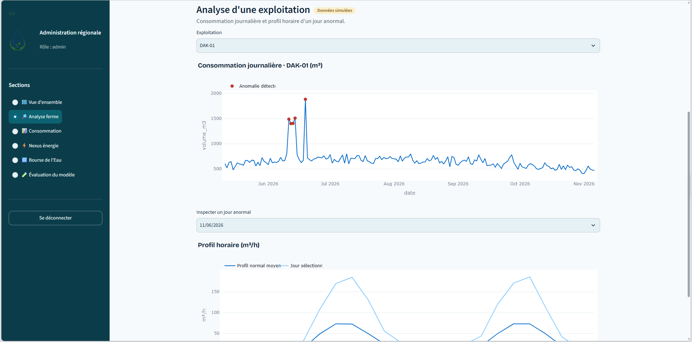
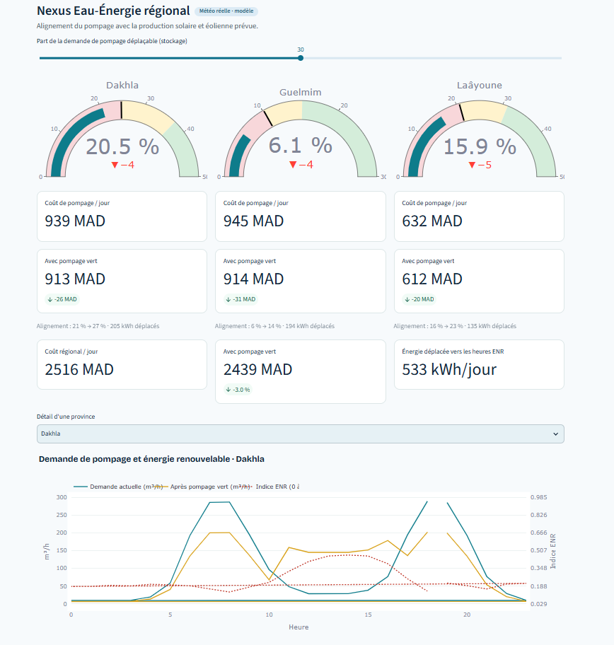
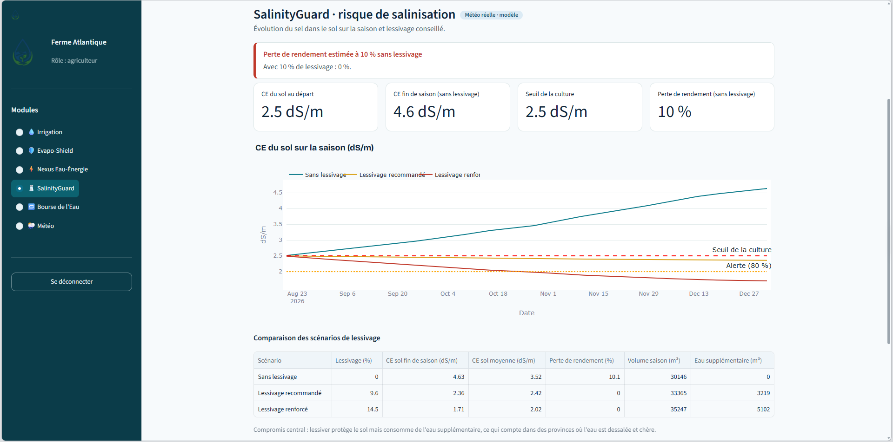
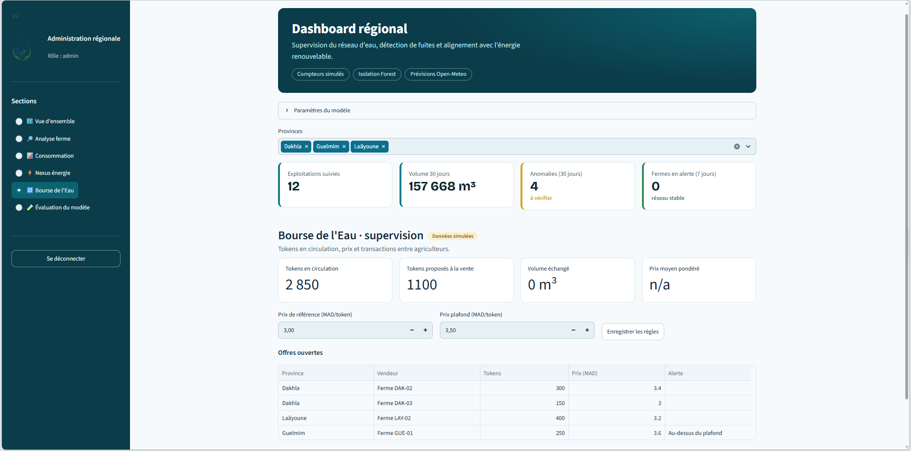

<div align="center">


# AquaPilot AI

**Gestion intelligente de l'eau pour les Provinces du Sud du Maroc**
Dakhla · Laâyoune · Guelmim

[**Démo en ligne**](LIEN_STREAMLIT) · [Signaler un problème](../../issues)

   

</div>

> Prototype réalisé pour le hackathon **« Innovons pour les Provinces du Sud »**.
> La météo est réelle ; les compteurs d'eau, les fuites et la Bourse de l'Eau sont **simulés**. Voir [Transparence des données](#transparence-des-données).

<details>
<summary>Plus de captures</summary>








</details>

## Le problème

Dans les provinces du Sud, le climat est hyper-aride, le vent sec (Chergui) accélère l'évaporation, et l'agriculture dépend de plus en plus de l'eau de mer dessalée. Chaque mètre cube coûte cher, et une eau mal dosée finit par saliniser les sols. Les gestionnaires manquent de visibilité sur les fuites et les pointes de demande, et les agriculteurs d'outils simples pour décider quand et combien irriguer.

## La solution

AquaPilot AI est une plateforme web à deux vues, selon le rôle de l'utilisateur :

- **Gestionnaire** : supervise le réseau d'une région (fuites, consommation, énergie, marché de l'eau).
- **Agriculteur** : reçoit des recommandations d'irrigation adaptées à sa parcelle.

### Les quatre modules

| Module | Ce qu'il fait |
|---|---|
| **SalinityGuard** | Simule le bilan de sel du sol sur la saison, compare plusieurs scénarios de lessivage et donne des recommandations de début, de milieu et de fin de saison. |
| **Nexus Eau-Énergie** | Recommande de pomper quand l'énergie solaire et éolienne prévue est la plus abondante, pour réduire le coût de pompage. Vue agriculteur et vue régionale (jauges d'alignement). |
| **Evapo-Shield AI** | Calcule un risque d'évaporation à partir de la température, de l'humidité et du vent, détecte les épisodes de Chergui, bloque l'irrigation aux mauvais moments et propose les meilleurs créneaux. |
| **Bourse de l'Eau** | Les agriculteurs qui économisent plus de 20 % de leur quota gagnent des *Water Tokens* (1 token = 1 m³) qu'ils peuvent vendre ou acheter dans leur province. L'administration fixe prix de référence et plafond. |

### Côté gestionnaire

- Carte satellite des exploitations avec alertes.
- **Détection de fuites par Isolation Forest** (apprentissage non supervisé), avec diagnostic du type d'anomalie (fuite nocturne, surconsommation…).
- Comparaison de la consommation sur 30 jours et décomposition de l'écart.
- Analyse de la simultanéité des irrigations et simulation d'un décalage vers la nuit.
- Supervision de la Bourse de l'Eau et réglage des règles.

### Côté agriculteur

- Configuration de l'exploitation (province, culture, superficie, irrigation, salinité de l'eau) avec **localisation de la parcelle sur une carte**.
- Plan d'irrigation sur 7 jours (ET₀, coefficient cultural, stade de la culture) et comparaison de scénarios.
- Alertes Evapo-Shield, créneau de pompage vert, risque de salinisation, marché de tokens.

## Transparence des données

| Donnée | Statut | Source |
|---|---|---|
| Prévisions météo (température, vent, humidité, rayonnement, ET₀) | **Réelle** | [Open-Meteo](https://open-meteo.com) |
| Historique météo sur 90 jours | **Réelle** | [NASA POWER](https://power.larc.nasa.gov) |
| Climatologie de référence (SalinityGuard) | **Réelle** | Archive Open-Meteo |
| Imagerie satellite de fond | **Réelle** | Esri World Imagery |
| Compteurs d'eau et fuites | **Simulée** | Jeu de données synthétique généré par `core/synthetic.py` |
| Soldes de tokens, offres, transactions, quotas | **Simulée** | Stockage local JSON |
| Prix du kWh | **Hypothèse** | Tarification dynamique fictive, à remplacer par des données sourcées |
| Modèle de salinité, pertes par évaporation | **Modèle** | Hypothèses documentées dans l'application, à calibrer sur le terrain |

Les badges *Données réelles / simulées / Météo réelle · modèle* sont affichés sur chaque section de l'application.

## Détection de fuites : méthode et limites

Les consommations horaires sont agrégées par jour (volume, part de consommation nocturne, variabilité…). Un modèle **Isolation Forest** (scikit-learn) attribue à chaque jour un score d'anomalie ; un diagnostic simple distingue ensuite les types d'événements.

Les scores de précision et de rappel affichés dans l'application sont mesurés sur des fuites **que nous avons nous-mêmes injectées** dans les données simulées : ils sont donc optimistes. Sur un vrai réseau, chaque alerte devrait être confirmée sur le terrain.

## Architecture

```
app.py                 Point d'entrée : connexion et navigation par rôle
views/
  regional.py          Dashboard gestionnaire
  farm.py              Dashboard agriculteur
core/                  Logique métier
  agro.py              ET₀, besoins en eau, scénarios d'irrigation
  evapo.py             Risque d'évaporation, blocage, Chergui
  nexus.py             Pompage vert (parcelle et région)
  salinity.py          Bilan de sel et recommandations
  anomaly.py           Isolation Forest et diagnostic
  synthetic.py         Génération des données simulées
  network.py           Profils régionaux, simultanéité
  bourse.py            Règles et transactions de la Bourse
  auth.py, storage.py  Comptes de démo et stockage JSON
connectors/            Open-Meteo, NASA POWER, climatologie
ui/style.py            Thème et composants visuels
data/                  Données simulées et cache météo
```

## Installation

Prérequis : Python 3.12 ou plus récent.

```bash
git clone https://github.com/mohannadelhachimi/aquapilot-ai.git
cd aquapilot-ai
python -m venv .venv
source .venv/bin/activate        # Windows : .venv\Scripts\activate
pip install -r requirements.txt
streamlit run app.py
```

L'application s'ouvre sur http://localhost:8501. Une connexion internet est nécessaire (météo, fonds de carte, polices).

## Comptes de démonstration

| Rôle | Identifiant | Mot de passe |
|---|---|---|
| Gestionnaire | `admin` | `admin123` |
| Agriculteur | `ferme1` | `demo123` |

Ces comptes sont fictifs et servent uniquement à la démonstration. Sur la version en ligne, les modifications (exploitations, Bourse) peuvent être réinitialisées lors des redémarrages.

## Limites du prototype

- Aucun capteur physique : les compteurs sont simulés.
- Le modèle de salinité est un bilan de sel simplifié (sol limoneux, tolérance FAO-29) ; il doit être calibré avec des mesures de conductivité électrique.
- Les pertes par évaporation et les économies par système d'irrigation sont des hypothèses de modèle.
- La Bourse de l'Eau n'implique aucun paiement réel ni aucune validation réglementaire.
- L'authentification est une démonstration : elle n'est pas conçue pour un usage en production.
- **Le NDVI (stress hydrique des cultures via Sentinel-2) n'est pas inclus dans cette version.**

## Feuille de route

- [ ] Suivi de la santé des cultures par NDVI (Sentinel-2 via Google Earth Engine)
- [ ] Connexion à de vrais compteurs communicants
- [ ] Calibration du modèle de salinité avec des mesures de terrain
- [ ] Authentification et base de données de production
- [ ] Alertes par SMS ou WhatsApp pour les agriculteurs

## Technologies

Python · Streamlit · Pandas · NumPy · scikit-learn · Plotly · Folium · Open-Meteo · NASA POWER


## Licence et crédits

Code publié sous licence [MIT](LICENSE).
Données météo : [Open-Meteo](https://open-meteo.com) (CC BY 4.0) et [NASA POWER](https://power.larc.nasa.gov). Fonds de carte : Esri World Imagery.
